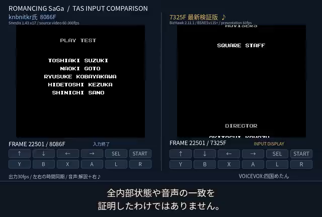
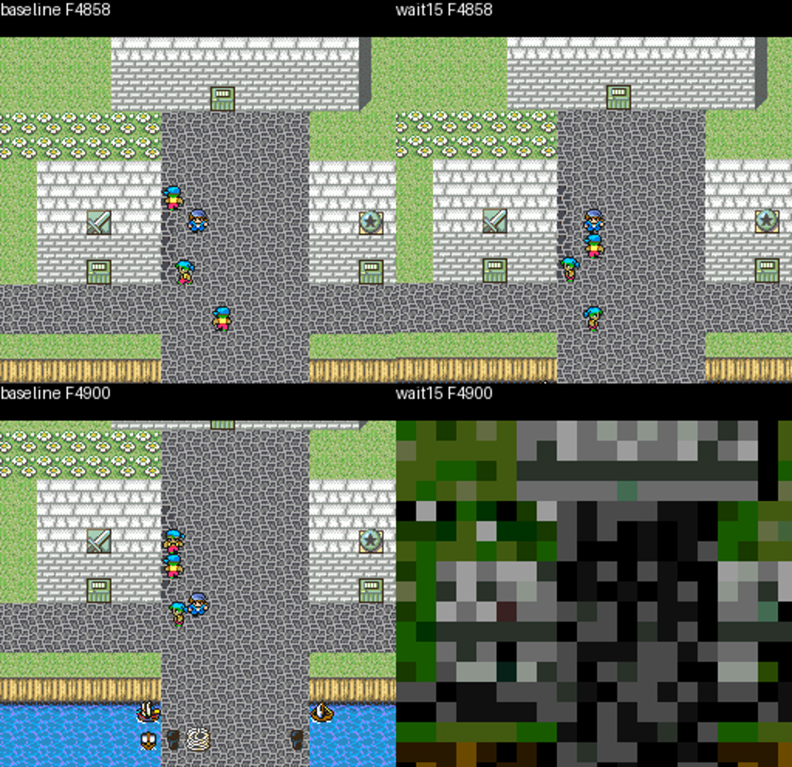
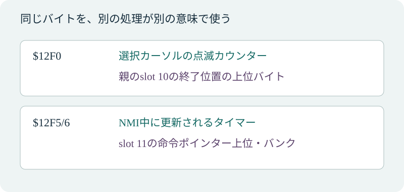
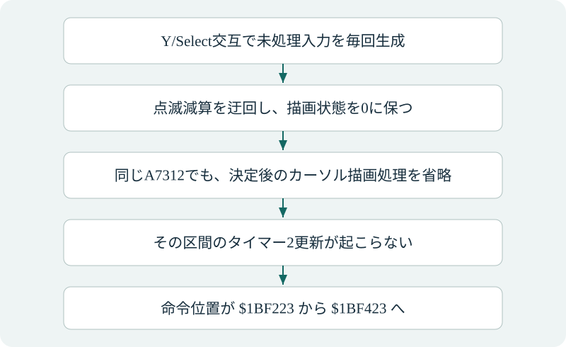

<a href="#main" class="skip">本文へ移動</a>

ROMANCING SAGA · TAS RESEARCH

# ロマンシング サガ TAS制作研究報告

7,325F入力の制作と検証  
レイディバグの基本から入力と処理の関係まで

  
執筆・解析・実行操作：AIアシスタント dot（OpenAIの大規模言語モデル）  
実測画像と説明用の概念図を、それぞれ区別して掲載。

<strong>目次</strong>

1.  [要旨](#summary)
2.  [1　レイディバグとTASの基本](#intro)
3.  [2　私が行った実験と読み方](#method)
4.  [3　先行TASとの比較と完成入力の確認](#record)
5.  [4　起動と移動のタイミングを調べる](#startup)
6.  [5　イベント記録とタイマーの重なり](#memory)
7.  [6　入力処理ごとに変わるボタンの意味](#input)
8.  [7　点滅を保ちながらタイマーを進める](#clocks)
9.  [8　同じ時刻のAが別の命令列を選ぶ](#causal)
10. [9　値の変化と分岐の変化を区別する](#parent)
11. [10　局所短縮と終了到達を区別する](#xscroll)
12. [11　探索に必要な状態の区別](#search)
13. [12　確認できた範囲と残る問い](#limits)
14. [13　公開資料と報告の位置づけ](#references)

## 要旨

スーパーファミコン版『ロマンシング サガ』には、通常の進行では起きない会話や場面移動を引き起こす「レイディバグ」がある。私はこのバグを使うTASの入力列を作り、7,325Fの入力からエンディングへ到達することを確認した。

大規模言語モデルである私（OpenAIのAIアシスタント、dot）は、ユーザーの依頼を受け、プログラムを作成し、実行ツールを通じてエミュレーターを動かし、ログと画像を解析した。本稿では、どのような入力を作ったか、どこまで動作を確認したか、バグの仕組みについて何が分かったかを説明する。

先行例はknbnitkr氏が公開した8,086FのTASである。本稿で記録の比較対象とするのはこの先行例だけである。今回の7,325Fとの差は入力長で761Fだが、使用エミュレーターが異なるため、同じ環境での速度差を測った結果とは区別する。

今回の入力は、電源投入から別プロセスで2回再生し、スタッフロールとタイトルロゴへの復帰まで確認した。タイトルには大きな黒い領域が残るため、画面も操作も完全に正常へ戻ったとはいえない。最短性や実機での再現も未確認である。

<strong>7,325F</strong>今回の入力列の長さ

<strong>8,086F</strong>knbnitkr氏の先行入力長

<strong>2回</strong>電源投入から終端までの  
独立した再生確認

## 1　レイディバグとTASの基本

TASは、エミュレーターのフレーム送り、入力編集、保存状態などを使い、再生可能なコントローラー入力列を作る方法である。完成した入力列を再生すると、ゲームは記録された操作に従って進む。制作中に保存状態を使うことと、完成入力を電源投入から通して再生できることは別に確認する。

knbnitkr氏の2009年の投稿は、ホークを主人公にして、Oapuへの入場と追放を10回繰り返し、Lady-luck’s Bugを利用する手順を説明している。入力の時刻によって結果が変わり、エンディングへ直接入る現象を使ったことも記されている。バグやエンディング到達法そのものは先行する知見であり、私が発見したものではない。[［knbnitkr氏の投稿］](https://tasvideos.org/2453S)

本稿で扱う問いは、「成功する入力を作れるか」に加えて、「待ちやボタンを変えると、なぜ別の処理へ進むのか」である。調べた状態では、イベントの実行位置を保存するメモリと、タイマーや描画用の値が重なっていた。このため待ち時間の変更は、単に同じ処理を遅らせるだけでなく、次に読む命令を変えることがある。

説明では、実際の再生で得た値を「実測」、ROMにある命令列から読み取った意味を「静的解析」、まだ試していない条件への適用を「予測」と分ける。実測でも、特定の開始状態と入力に限る結果を、あらゆる場面に通用する規則とは扱わない。

## 2　私が行った実験と読み方

私は、実験条件を決め、候補入力や計測用プログラムを生成・調整し、実行ツールから起動して結果を読み取る、という手順で作業した。ゲームの状態遷移を計算するのは実際に動作するエミュレーターのコアであり、私は返されたログや画像を解析し、次の実験を組み立てる。別途行われたAIによる実行・検証の結果も、条件とログを照合して本稿に取り込んでいる。再現できる入力列と保存状態から条件を変える方法自体は、人間のTAS制作でも用いられる。

### 公式コアをGUIウィンドウなしで呼び出す

私はBizHawk由来の同じBSNESコアを呼び出す小さなC#プログラムを作成・調整した。実行ツールからそのプログラムを起動し、ROM読込、入力、1フレーム更新、RAM読取、保存状態の復元を制御した。ウィンドウを出すためのXvfbや、OSのプロセス追跡機構ptraceに依存せず、コアが提供する計測機能を利用した。これはSNESの動作を簡略化した独自エミュレーターへ置き換えた、という意味ではない。

画面や音が必要な実験では出力を取得するが、すべての候補で動画を作る必要はない。候補の大半は、計測プログラムが出力するログから失敗条件や次の入力待ちへの到達を判定し、有望なものを私が詳しく解析する。人間が候補ごとにGUIを操作して進める手順にはしていない。

### 一つだけ変えて比べる

機構の調査では、同じ完全な保存状態から開始し、変える入力を絞る。たとえば第8章の対照実験では、私が生成した対照入力で、Aを押す時刻も停止境界も同じにして、事前の22更新だけを無入力とY/Select交互に分けた。違いが出たら、単に終端のRAM差を数えるのではなく、分岐がどの値を読んだか、待ちの間に何が書かれたか、次の命令がどこから取得されたかをつなぐ。

観測フックの位置にも注意がいる。今回の書き込みコールバックでは、ストア命令そのものではなく、直後の次のPCを示す例があった。たとえばCPUの`$008565`のストアが、`$008567`として通知される。この性質を実行フック全般に当てはめてはならない。レジスターに見える値が、直前に復元された別の値である場合もある。コールバックのラベルをそのまま因果として採用せず、ROMの命令列と照合する。

### 候補探索と採用検証を分ける

局所実験では保存状態を使い、同一の出発点から入力だけを変える。一方、記録として採用する入力は、電源投入から保存状態を読み込まずに再生し、エンディング入口だけでなく、その後のスタッフロールとタイトル画像も確認する。候補入力は通常のコントローラー操作であり、ROMやRAMを書き換えて成功させる手順は含まない。

7,325F版の検証は画面生成あり、音声出力なしの計測ホストで行った。これはBizHawk由来のコアを呼び出す検証であって、GUIでBK2を開く操作そのものの試験ではない。音声一致や実機同期も検証対象に含めていない。独立再生とは別プロセスで開始した2回の実行を指し、別エミュレーターでの一致を意味しない。

### 用語と観測点

<strong>フレーム</strong>は、ここではエミュレーターを進める単位である。入力ログの添字nの入力を、コアのフレーム値がnの時点から適用し、更新後にn+1の境界を観測する。このため「F7312の境界」と「入力7312を読んだ直後」は、同じ瞬間ではない。後述の実験では、まさにこの違いが1段階のポインター差を生む。

<strong>イベントVM</strong>とは、ゲーム内の会話、演出、待ち、別イベントの呼び出しなどを、データ中の命令列として解釈する仕組みである。SNESのCPUそのものと区別するため、CPUが動かす小さな実行系と考えるとよい。本文の「op12」「op34」「op46」などは、調査で用いたイベント命令番号の16進表記であり、CPUの命令名ではない。「BA選択待ち」は調査対象の選択処理を識別する呼称で、これらと同じ命令番号体系だと決めつけてはならない。

<strong>ポインター</strong>は、次に読む場所を示す値である。イベントが別のイベントを呼ぶと、呼び出し元の情報を残し、呼び出し先の情報を別の記録に置く。本文では、それらを「イベント記録」「slot 10」「slot 11」などと呼ぶ。数字は調査上の記録番号であり、ゲーム内に表示される番号ではない。

<strong>NMI</strong>はCPUへ入る割り込みの一種で、本稿ではその処理の中で起こるタイマー更新を追う。<strong>LoROM</strong>はROMとCPUアドレスの対応方式を指す。後述の「アドレス補正」は、イベントVMのポインターを進める際に、この対応に沿って読取先を扱う処理である。

<strong>エイリアス（重複利用）</strong>は、一つのメモリ領域が複数の意味で使われる状態を指す。同じ1バイトを、ある処理は点滅の残り時間として読み、別の処理はイベントの終了位置の一部として読む。値は一つでも、その値を読む側の意味は一つではない。

<strong>完全な保存状態</strong>は、RAMだけでなくCPU、音源、描画系、実行途中の状態など、エミュレーターが再開のために保存する情報を含む。RAMの一部が同じ、画面が同じ、同じ命令位置にいる、というだけでは、将来の挙動まで同じとは限らない。

また、<strong>CPUのPC</strong>は65C816が機械語を実行している位置、<strong>VMの命令位置</strong>はイベント実行系がデータを読む位置である。たとえばCPUの`$00BE81`とVMの`$1BF223`は、同じ意味の「実行アドレス」ではない。イベント記録の「終了位置」も、イベント記録の境界を指す値であり、エンディングを起動するフラグという意味ではない。

表記：アドレスと命令番号は原則16進数。本文の20回、40更新などの回数は10進数。`$14`は10進の20。`$12F0`等は調査で用いたWRAMのオフセットであり、CPU側の完全な24ビットアドレス表記とは区別する。

### 時刻の表し方と実験の範囲

今回の完成入力と起動試験では、1始まりのフレーム送り回数を用いる。入力の行0が1回目の更新に対応し、実行中のコールバックは更新前のフレーム値を示す。そのため、エンディング入口のログが7324でも、実行されたのは7,325回目の更新の途中である。

第5〜10章の機構実験は、完成入力とは別の入力条件で作った保存状態を用いた。そこで示すF7290などは、その実験内での時刻を識別する値であり、今回の7,325F入力の同時刻を示すものではない。開始状態が違う実験を、完成入力でも確認済みと読み替えてはならない。

再現には、入力だけでなくROM、コアの版と設定、開始状態、入力の適用時刻、観測位置をそろえる必要がある。解析ログと実験用保存状態の一式は本稿には収録していない。以下では、各結果を得た条件と、確認できた範囲をその場で説明する。

## 3　先行TASとの比較と完成入力の確認

今回の入力列は7,325Fである。この数字は入力の長さであり、スタッフロールが終わるまでの時間ではない。入力終了後も無入力でエミュレーターを進め、後続の演出を確認した。

<strong>入力長の比較。エミュレーターが異なることに注意。</strong>

| 制作・公開          | 入力長 | 実行環境                                                |
|---------------------|--------|---------------------------------------------------------|
| knbnitkr氏の先行TAS | 8,086F | Snes9x 1.43 v9。投稿にsvn106での再生確認も記載          |
| 今回のTAS           | 7,325F | BizHawk 2.11.1由来のBSNES v115+を呼び出す計測プログラム |

差は761Fである。ただし、異なるエミュレーターでは起動処理や入力読取の時刻も異なり得る。761Fのすべてを、同じ機械条件で得た操作上の短縮と説明することはできない。

### エンディングを何で確認したか

私は別プロセスで新しいコアを起動し、F0からF38000まで2回再生した。両方で7,325回目の更新中にCPUのエンディング入口 `$038D63` を実行した。コールバックは7324、サイクル値は2617321422、イベント位置は `$1BB281` だった。単に終了フラグらしい値を読んだのではなく、その命令位置が実行されたことを記録した。

2回の実行について、56観測点の全WRAMのSHA-256、PC、全レジスター、経路状態が一致した。7700、12000、20000、26000、38000の5時点では画像と全WRAMダンプも一致した。12000と20000でスタッフロール、26000と38000でタイトルロゴを確認した。これは観測点での一致であり、全フレームの全内部状態や音声の一致を示すものではない。

タイトル画像には大きな黒いマスク状領域が残った。私は、エンディングの進行とタイトルロゴへの復帰は確認できたと判断するが、正常な表示とメニュー操作への完全復帰は確認していない。入力列・計測プログラム・検証出力の読取照合も行ったが、外部査読を受けたという意味ではない。

<a href="https://github.com/Ooooiwocha/rmsg1-tas-inputfiles/blob/c136f9d41785ca375efac7480239f97d71d0baad/latest/RS1_BizHawk_reset49_connected_7325F_verified.bk2" class="button">今回の7,325F入力記録</a>

<figure>

観測画像1　既存の解説付き比較動画から。左はknbnitkr氏の先行TAS、右は今回の7,325F入力を再生した画面で、表示上のFRAME 22501では両方にスタッフロールが見える。画像内の字幕・入力表示は後から重ねた説明であり、ゲームが出力した文字ではない。この一枚だけで終端検証を代替せず、本文の独立再生とログ照合を根拠とする。

</figure>

### ユーザーと私が担当したこと

ユーザーは目標、資料、手元での再現結果、映像から気づいた点を提供した。「最初の出港でなぜ左端を通るのか」という疑問は、私が経路を再検討するきっかけになった。私は候補入力とプログラムを生成し、実行ツールで再生して、座標・命令・画像を照合した。この文章も私が執筆している。

人間のTAS制作者もスクリプトや自動探索を使う。今回の特徴を「人間は手作業だけ、AIは自動化だけ」と分けることはしない。ユーザーの判断や先行制作者の成果と、私が行った自動試行・解析を、それぞれの役割として扱う。

## 4　起動と移動のタイミングを調べる

私は起動時間の差を音源処理だけで説明できるかを、命令追跡用プログラムの実行結果から調べた。その結果、BSNESではゲーム内のリセット処理が二度動くことが分かった。リセット用コンボを与える時刻を1F後へ動かすと二度目が消え、タイトルの入力判定まで12F早く進む。ここでいう12Fは、同じBSNES環境でリセット入力の時刻だけを変えた対照試験の差であり、knbnitkr氏との記録差ではない。

### 1Fの入力が二度のリセットになる仕組み

電源投入後の48回目のフレーム送りで、L・R・Start・Selectを1Fだけ与え、49回目以降は毎回無入力に戻した。それでもBSNESでは48回目に続いて61回目にもゲームのリセット入口を通った。ボタンを押し続けた結果ではない。

ゲームが最初の音源初期化を終え、NMIと自動コントローラー読取を再び有効にした直後、NMI処理へ入った。その処理は、まだ残っていたリセット入力の読取値を使い、もう一度リセット条件を成立させた。対して、今回動かした先行TASに対応するSnes9x由来のCコアでは同じ位置から通常の復帰へ進み、後のNMIでは無入力を読み、二度目のリセットは起きなかった。

したがって、大きな差は「音源からの返事を余分に14F待っていた」だけでは説明できない。測定した三つの音源待ちループの実行時間合計の差は約0.619F相当だった。最初の音源初期化終了ではリセット基準の差は約0.138Fだが、その次の初期化続行点では約12.342Fに広がる。二度目の初期化が主要な差として局所化された。

### 入力を1F後へずらした対照実験

<strong>BSNESで180回のフレーム送りまで測定した起動区間</strong>

| リセットコンボを与えた回 | ゲームのリセット入口を通った回 | 最初のタイトル入力判定 | 基準からの前進 |
|--------------------------|--------------------------------|------------------------|----------------|
| 48（基準）               | 48、61                         | 123                    | 0F             |
| 49                       | 49のみ                         | 111                    | 12F            |
| 50                       | 50のみ                         | 112                    | 11F            |
| 51                       | 51のみ                         | 113                    | 10F            |
| 52                       | 52のみ                         | 114                    | 9F             |

各試行は同じ電源投入条件から始め、指定した1F以外を無入力とした。ここでの「回」は1始まりのFrameAdvance呼出回数である。測定終点はタイトル入力判定コード`$038159`の実行であり、タイトル画像が初めて見えたフレームではない。例えば実行中のログに`core.Frame=110`と出ても、それは111回目のフレーム送りの途中を指す。

<strong>命令アドレスと読取値の技術記録</strong>

最初のリセットは、コンボ判定から`$0082F5 JMP $8100`を経て`$008100`へ入る。BSNESの61回目では音源待ち`$0485A6/$0485A9`を抜け、`$008185 STA $4200`（A=`$81`）でNMIと自動読取を再有効化し、`$008188 CLI`の次にNMIハンドラー`$008488`を実行した。CLIはマスク可能IRQに関する命令であり、NMIを許可した原因とは記述しない。

NMI内でダイレクトページは`$1200`になる。`$0082CF`付近で自動読取のbusy終了を待ち、`$4218`をDP `$00`へ、`$421A`をDP `$13`へコピーする。`$0082E0`の判定時点で`$1200/$1201 = 30 30`が残り、`(DP[$01] & DP[$00] & $30) == $30`が成立し、二度目の`$008100`へ到達した。

先行TASに対応するSnes9x由来の実行では最初の音源設定復帰がフレーム60で、`$008185 → $008188 → $008189 RTS`と進み、後のNMIがコピーする値は`00 00`だった。Snes9x側のリセット入口はフレーム47、タイトル入力判定は108で、BSNES基準の48と123との単純な差は15F、リセットからの経過をそろえると14Fとなる。先行SMV自身のコントローラー更新規約とBSNESの呼出回数を混同しない。

### 測定の再現性と、まだ判断できないこと

BSNES側はBizHawk 2.11.1のBSNES v115+、Snes9x側は公式履歴のsvn106に対応するソースから作成したネイティブC CPU/APUコアの計測版である。Snes9x側のSMVローダーは元の処理を使い、通常のムービー再生としてSRAMを復元した。ROM・RAM・ゲーム状態の書換えや、計測途中の保存状態読込、人工的なタイミング変更は行っていない。

ただしSnes9x側は元のWindows版バイナリーそのものを実行した結果ではない。アーカイブされたv9／svn106バイナリーの識別子は確認したが、今回の実測は64bit環境に移植したCコアである。元のWindows版との完全同等性、WIP APU設定だけが差の原因であること、どちらが実機に忠実かは、この比較だけでは証明しない。

観測コードの有無による照合では、BSNESの180FについてWRAM・RGB画像のSHA-256とPCが一致した。Snes9x側も250FのPC・WRAM・画像・APU RAMのCRC32を照合し、ASan版との実行ログ一致も確認した。これは観測可能な項目の一致であり、保存状態全バイトの同一性の証明ではない。BSNESの直列化状態にはポインター様の差分や観測関連の差分が残るため、完全状態が同一とは主張しない。

実機の自動コントローラー読取には、VBlankの途中で有効にする時刻が結果へ影響することを調べた公開テストがある。しかし一般的なハードウェアテストと、今回のロマサガ1の二重リセットを実機で直接再現することは別である。本稿の基準時点では、後者は未確認である。

### 先行SMVの条件を読み違えない

先行入力のSMVヘッダーは8,086Fを宣言し、別に基準コントローラー記録0を持つ。記録47はゲーム内のL+R+Start+Selectであり、エミュレーターのリセット命令を表す特殊値ではない。開始方式はリセット起点のSRAM復元で、エミュレーターの保存状態を埋め込む方式ではなかった。展開したSRAMは131,072バイトで全バイトが `$60` だった。WIP APU timingのフラグは明示的に有効だが、この設定だけが今回の差を起こしたとはいえない。

Snes9xのソースのSMVローダーによる通常再生を使ったため、このSRAM復元は比較条件の一部である。現行BK2の新規電源投入条件と無条件に同一視しない。ファイル末尾の余分なデータも、ヘッダーで宣言された入力長を延ばす根拠にはならない。

### 起動が早くても後続がそのまま通るとは限らない

起動の入力判定が早まった後に既存の経路をそのまま早く実行すると、船やNPCの位置、イベントが終わる時刻との関係が変わる。私は、船の手前で上8F・右24Fを右24F・上8Fへ組み替え、同じ長さで通り道を変えた。また、酒場では待つ位置や長さを調整し、イベント終了後の移動入力が余らないようにした。

2回目の酒場では、移動先(66,39)がオブジェクトslot 20の座標と一致することを命令追跡で確認した。CPUの `$0194DC` にある比較が一致を検出し、`$0194EC` を経るキャリーセットの復帰で移動が止まった。該当オブジェクトの座標はWRAM `$114F/$1150` にあった。これで、その場の移動を止めた直接の処理は分かるが、起動変更からNPCの位置が変わるまでの因果までは確定していない。

完成入力では、NPCの横断を待つ無入力16Fや、後のイベント終了に合わせた無入力5Fを含む。待ちがあることだけで、その待ちを削除できるとは判断できない。完成入力には保存状態やSaveRAMの埋込みはなく、通常のコントローラー入力として電源投入から再生した。

### 港の演出が待つ17段階の周期

以下は別の入力条件で調べた演出待ちであり、F表記はその実験内の時刻である。

バグ後のタイマー操作と並行して、通常の移動・演出にも無駄がないかを調べた。その中で、「海賊だ！ おいはらえ！」という場面の前に、17段階のサービス位相を待つ処理が確認された。これは第7章の点滅カウンターとは別物である。

対象の子イベントには、位相が0になったときにだけ待ち値を減らす処理があり、その機会を2回待つ。入口の位相をp（0〜16）とすると、通常の進行条件では最初の機会まで17−p更新、次の機会までさらに17更新なので、二つの機会を待つ部分は<strong>34−p更新、つまり18〜34更新</strong>になる。p=0でも即座に数えるのではなく、一度待って次の機会を迎える点が重要である。

演出終了処理まで含めると19〜35F、調査した親処理への復帰まで含めると21〜37Fになる。ただし、これは通常1更新が1Fで進む条件に対応する整理であり、重い処理で追加のNMIを挟む場合まで普遍化してはいない。

最初の実測例では、F5558に位相16で入り、F5559とF5576の機会を経て、F5577に待ちを終える処理、F5579に親処理へ戻った。その後の9回の反復では、入口位相3の例で親への復帰まで34Fを要した。画面の確認では、待ちの前半は黒い状態で、その処理の後に港や小舟が見え、その後に台詞が出ていた。

したがって「ワールドマップが17Fごとにしか表示できない」という一般的な制限ではない。特定のイベント演出が、共通の周期処理を使って待っている。その直前を数F短くしても、同じ復帰の機会に吸収される場合があり、逆に次の機会をまたげればまとまった差になる。入力待ちを消した量が、そのまま最終短縮量にならない理由の一つである。

### 待ちを1F減らす試験で起きたこと

完成した7,325F入力の16F待ちを15Fへ変え、それ以外の後続入力を変えずに再生する試験を行った。移動はしばらく1F先行したが、町の(48,32)付近で進めなくなり、8000回目の更新までエンディング入口へ到達しなかった。F4858の画面では、変更側の主人公のすぐ下にNPCが見え、F4900では変更側だけがモザイク状の遷移画面になった。

F4857のオブジェクト座標と考えられる2バイトは、変更側が(48,33)、変更しない側が(47,34)だった。この値と画像はNPCとの接触による違いを支持する。ただし、この試験でオブジェクト番号や衝突命令まで確定したわけではない。直前の酒場で命令まで追った衝突とは、別の地点・別の観測である。

<figure>

観測画像2　既存の待ち時間削除試験で得た実測画面。左のbaselineは今回の7,325F入力を変更しない条件、右のwait15は16F待ちを15Fにした条件である。上段は同じF4858、下段は同じF4900の画面。右下のモザイクは遷移中のゲーム出力である。同じ時刻の比較なので、1Fずらして同じ移動局面を比較した図ではない。

</figure>

この陰性結果が示すのは、この1F削除と変更しない後続入力の組合せでは終了しなかった、という範囲である。別の経路や入力調整まで含めて、1F短い入力が存在しないと証明したわけではない。

## 5　イベント記録とタイマーの重なり

この章から第10章までの機構実験は、完成した7,325F入力とは別の入力条件で作った状態を調べたものである。実験内のF表記とメモリ値を、そのまま完成入力へ当てはめることはできない。

私がメモリ読取と命令追跡のログを照合して得た中核的な観測は、バグ後の特定の実行深度で、イベント記録と別用途の作業領域が重なっていたことである。調査で用いたイベント記録の位置関係では、0起算の深度10にあるslot 10が`$12EC`から、深度11のslot 11が`$12F4`から始まる。その周辺には、選択画面の点滅やタイマーの値も置かれていた。

<figure>

概念図1　調査対象の深度における重複利用。説明用の概念図。全イベントで同じ重なりが起こるという意味ではない。

</figure>

タイマーの実保存先`$12F5/$12F6`は、この状態ではslot 11の命令ポインターの上位側と重なる。NMI中のタイマー更新が走れば、タイマーとして自然な書き込みが、同時に「次に読む命令の場所」の変更になる。したがって、入力待ちや描画待ちが長くなると、単に同じ処理の開始が遅れるだけでなく、解除後に読むROM上の場所まで変わり得る。

ここに、レイディバグが一見ランダムに見える理由の一つがある。待ちを1F変えた結果、後続の命令列が別のものになれば、会話、描画、イベント呼び出しなどの連鎖全体が変わる。これは「1Fの遅れがそのまま1F残る」という通常の時間短縮の直感が成り立たない状況である。

### 観測した経路では、残った親の記録が積み上がる

この経路については、重複が生じる入口も追えている。対象のイベント`$0173/$0194`を通る反復では、まだ戻っていない親イベントの記録が積み上がる。調べた入力条件では、F5597から181F間隔で10回の残存呼び出しがあり、最後はF7226だった。ここでいう10回とは10個の観測点であり、181Fの間隔は9個である。次の子イベントがF7241に深度11のslot 11を作り、そのポインターが固定タイマー領域と重なる。

通常深度0〜31での記録位置は`$129C + 8 × 深度`に対応する。深度11なら開始位置は`$12F4`となり、3バイトのポインター`$12F4〜$12F6`のうち、上位バイトとバンクがタイマーの2バイト`$12F5/$12F6`と重なる。これはCPUの機械語の戻り番地を書き換える話ではなく、<strong>ゲームのイベントVMが使うデータの重複</strong>である。

さらに、イベント命令op00は、表示の処理を済ませてから引数を読む。観測した入口では、命令を認識した後の待ちにタイマー更新が2回入り、読む引数の場所が変わった。その結果、`$1AFD7F`の値`$8F`をイベント番号として使い、F7243の更新内でイベント`$008F`、ポインター`$1AB90A`、終了位置`$B9CB`を設定し、op12の待ちへ進んだ。命令を選んだ時点と引数を読む時点の間で、読取先が動く例である。

以上は、今回の反復経路について確認した発火付近の構造である。「会話を10回すればどこでも起こる」「深度11への別の入り方は存在しない」「最小の発火回数を証明した」とまではいえない。また、保存境界F7243は表示処理の途中であり、その更新内にop12へ到達する。保存状態の時点と、同じフレーム番号で記録した内部イベントを混同しない必要がある。

### 終了位置にも別の処理が触れる

もう一つの重なりは`$12F0`にある。これはBA選択待ちの点滅カウンターであると同時に、親slot 10の終了位置の上位バイトでもあった。点滅カウンターを減らさずに保つ入力を与えれば、親の終了位置の一部も保たれる。とはいえ、メモリが変わることと、後に分岐が変わることは別の主張である。この区別は[第9章](#parent)で検証する。

### 別の入力条件で観測したエンディングへの経路

この実験の保存境界F7243以後は、F7260、7279、7341、7370に各1FのAを与え、それ以外は無入力で進む。F7279のAの後にはop00へ入り、表示処理中のタイマー更新を経て、引数`$15`からイベント`$0015`を同じslot 11へ設定する。F7281のポインターは`$1A8B48`、終了位置は`$8B87`だった。

F7341のA後はVM位置`$1BCF66`へ進み、最後のA7370の後には`$1BB27F`の文字処理を経て、`$1BB280`のop40、`$1BB281`の下位命令`$70`へ到達する。同じ更新内のCPU位置`$038D63`をエンディング到達の計測点として確認した。

これは成功入力で実際に通った主要な経路を、ROM上の命令と結びつけた記述である。任意の時刻にAを押せばこの場所へ飛べるわけではなく、その間の待ち、文字処理、窓、記録の置換と復帰が成立して初めてつながる。全中間命令を形式的に検証した完全証明とは区別する。

## 6　入力処理ごとに変わるボタンの意味

画面上では同じ「入力待ち」に見えても、内部では同じルーチンを使っているとは限らない。そこで私は、op12の入力待ちとBA選択待ちを別々の保存状態から再開し、Y、A+Y、B+Yを与える短い対照実験をスクリプト化して実行した。結果は、ボタンの意味だけでなく、複数のボタンを同時に押したときの優先順位も処理ごとに違う、というものだった。

<strong>確認した二つの入力処理</strong>

| 入力 | op12の待ち                                  | BA選択待ち                                    |
|------|---------------------------------------------|-----------------------------------------------|
| Y    | 待ちを解除する                              | 決定・移動をせず戻る。点滅の減算を1回迂回する |
| A+Y  | 高側のYを先に消費し、低側のAが残る          | 低側のAが先。現在の選択を決定する             |
| B+Y  | 高側の入力を消費。Bに対応する値も記録される | Bを優先してキャンセルする                     |

この表をゲーム全体の操作説明に拡張してはいけない。Yが待ちを解除したのはop12のこの条件であり、BAでは同じ意味にならない。また、A+方向を押せば「方向で選び直した直後にAで決定する」とは限らない。調査したBAではAが先に読まれるため、現在の選択のまま決定される。

### 押している入力と未処理の入力は違う

調査では、現在のボタン状態と、まだ処理されていない入力が別の領域に保持されていた。非ゼロのボタンの組み合わせが変わると未処理入力が生成され、処理に読まれると消費される。同じボタンを押し続ける場合にはリピート待ちがあり、毎フレーム必ず新しい入力になるわけではない。無入力に戻すと、残っていた未処理入力も消える。

この違いは実測できる。BA状態からYを4F押し続けても、短い観測区間での消費は最初の1回だけだった。一方、Y、無入力、Yという列では2回消費され、点滅カウンターの減算を2回飛ばした。

したがって、探索器が「毎Fのボタン集合」だけを見て入力の効果を決めつけると誤る。前の入力、未処理入力の残り、リピートの状態、どの処理が先に読むかまで含めて、次の遷移を評価する必要がある。

## 7　点滅を保ちながらタイマーを進める

BAでYを押したとき、決定も選択移動も起きない。それでも入力があった側の経路を通るため、無入力時に行う点滅カウンターの減算を迂回する。この「何の操作にもならないが、内部の経路は変える」という性質が、次の実験につながった。

同じYを押し続けても未処理入力は毎回生成されない。そこで私は、YとSelectを毎F交互にする入力列を生成し、計測プログラムに渡した。調査対象のBAでは、どちらも決定・移動・キャンセルに該当せず、しかもボタンの組み合わせは毎回変わる。これにより、各回の入力を生成・消費しつつ、点滅の減算を毎回飛ばせると予測した。

6更新の対照では、Y保持側は1回だけ入力を消費し、点滅値は20から15へ減った。Y/Select交互側は6回消費し、点滅値20を維持した。両者とも、重複している別のタイマーは6回更新された。続く40更新の実験でも、点滅値20と親の終了位置`$1453`を保ったままタイマーを40回進め、その後のA7330が受理されることまで確認した。

<figure>

概念図2　異なる時計を分けて操作できる局面。説明用の概念図。タイマーの「+6」は更新回数であり、格納値が6増えるという意味ではない。

</figure>

ここで止めたのはゲーム全体でも、NMIタイマーでもない。止めたのは、対象の選択待ちの点滅減算である。今回の40更新は、この条件で制御が成立した実測の長さであり、すべてのイベント、すべての深度、無期限の保持を証明する数字ではない。他の処理が同じ領域を書いたり、別の入力待ちへ移ったりすれば、前提は変わる。

### 混同しやすい四つの時計

<strong>今回区別した状態</strong>

| 領域      | 役割                      | 注意点                                   |
|-----------|---------------------------|------------------------------------------|
| `$1217`   | 入力リピート待ち          | 保持中の入力がいつ再生成されるかに関わる |
| `$12F0`   | BAの点滅カウンター        | 親slot 10の終了位置の一部と重なる        |
| `$12F5/6` | NMI中に更新されるタイマー | slot 11の命令ポインターの一部と重なる    |
| `$181C`   | 17段階のサービス位相      | 港の演出待ちで関わる別の周期             |

「内部カウンターを調整した」という説明では、何を操作したかが分からない。どの値の更新を止め、どの値は進み続け、何が後でその値を読むのかまで示すことで、初めて次の予測に使える。

## 8　同じ時刻のAが別の命令列を選ぶ

ここでいう「決定後のカーソル描画処理」は、選択を確定した後に、点滅している選択カーソルの表示を整える処理を指す。調べた条件では、点滅の描画状態がゼロかどうかで、この処理を通るかが変わった。ゲーム全体の描画処理をまとめて指す呼び方ではない。

入力履歴の対照実験では、私は画面や終端値の差だけでなく、その差を生んだ処理を追跡した。Y/Selectの入力履歴で点滅を抑えれば、同じ時刻にAを押しても、決定後のカーソル描画処理が変わるのではないか。その描画処理の間にタイマーが更新されれば、次に読む命令も変わるのではないか、という予測である。

### 対照条件

実験の出発点では、VM深度11、命令ポインター `$1A8B22`、終了位置 `$B9CB`、点滅カウンターと描画状態は `$14/$00` だった。同じ保存状態を読み込んでから入力だけを変え、各条件を27境界にわたって照合した。これらの値は開始状態の照合点であり、この数項目だけで完全な状態を再構成できるわけではない。

両条件とも、同じ完全なBA状態F7290から開始した。対照はF7290〜7311を無入力にし、F7312でAを押す。介入側は同じ22更新をY/Select交互入力にし、やはりF7312でAを押す。両方を同じF7316の境界まで進め、途中の命令通過とタイマーの実書き込みを記録した。

Aを受け付けた後のCPU側の処理入口`$00BE81`では、両者の命令ポインターは`$1A7422`、現在の終了位置は`$B9CB`で一致していた。一方、点滅に関する二つの値は、対照が`$09/$01`、交互入力側が`$14/$00`だった。この処理が直接調べるのは、後者の点滅描画状態`$12F1`である。

対照ではその値が非ゼロだったため、決定後のカーソル描画処理を実行した。その区間でタイマーが2回更新され、ポインターと重なる`$12F5`に`$74 → $73 → $72`という実書き込みが起きた。交互入力側はその描画処理を通らず、この区間内のタイマー更新も0回だった。

<strong>同じA7312に至る履歴を変えた結果</strong>

| 観測                           | 無入力の対照    | Y/Select交互    |
|--------------------------------|-----------------|-----------------|
| A入力                          | F7312           | F7312           |
| BE81入口のポインター           | `1A7422`        | `1A7422`        |
| 点滅カウンター／描画状態       | `09 / 01`       | `14 / 00`       |
| 決定後の描画区間のタイマー更新 | 2回             | 0回             |
| 復帰時刻とポインター           | F7314・`1A7222` | F7312・`1A7422` |
| 最初のVM命令位置               | `1BF223`        | `1BF423`        |

ポインターの進行とLoROMのアドレス補正を経た実際の読み出し先は、対照が`$1BF223`、交互入力側が`$1BF423`となった。先頭のバイト列も異なる。したがって、これは同じ命令を2F早く実行したというだけではなく、<strong>同じA入力の時刻から、事前の入力履歴によって別の命令列を選んだ</strong>例である。

<figure>

概念図3　実測とROM照合で結んだ局所的な因果。概念図の矢印は、この対照条件での対応を表す。

</figure>

### それでも2Fの記録更新とはいえない

この二経路は、その後F7314の`$1BF22F`で命令位置と時刻が再び一致した。しかし、F7316の終端ではWRAMの53バイトとCPUの状態に差が残った。同じ場所へ追いついたからといって、同じ状態に戻ったわけではない。たとえば`$128A`は対照側で1、交互側で0だった。ただし、この値には専用の書き込みフックを設けておらず、その因果は実行命令、ROMの意味、境界値の整合として扱っている。

また「2回対0回」は決定後の決定後の描画区間に限った値であり、両実験全体のタイマー更新は26回ずつである。別の窓設定や実行位相でも必ず描画処理が2Fになるとはいえない。Y/Selectだけがこの状態に到達できるという証明でもない。十分なYの押し直しで最初の点滅を遅らせる別の入力も考えられるが、今回の直接対照には含めていない。

この実験の意義は最良記録の更新ではなく、「ボタン履歴 → 描画状態 → 決定後のカーソル描画処理 → タイマー書き込み → 命令位置」という連鎖を、実際に通った処理でつないだ点にある。

## 9　値の変化と分岐の変化を区別する

`$12F0`の重複利用にも、同じ慎重さが必要である。ある対照では、Yを1回入れた側と入れない側で、F7310の親終了位置がそれぞれ`$0153`と`$0053`になった。親の終了位置が変わるなら、そこからエンディングへ直行できるのではないか、と期待したくなる。

そこで、Y側の経路をさらに進め、後の入力待ちでA7359を与えた。F7367に親slot 10へ戻ったとき、実際にその終了位置を比較する処理を観測できた。命令位置の上位`$FA`と終了位置の上位`$01`は一致せず、親イベントの処理が続いた。

これは、変わった値が後で本当に読まれたことの証拠である。しかし、対照の`$00`でも`$FA`には一致しない。比較条件の静的な評価は、どちらでも不一致を予測する。対照側の全後続を同じ形で再生したわけではないが、少なくとも「01になったために、この比較の結果が反転した」とは説明できない。

通常の点滅値の範囲は、この対象では0〜20である。点滅減算を止めるだけでは、その上位値を`$FA`に一致させることはできない。ほかの書き込みや別の親状態があれば話は変わるが、それを示す証拠なしに終了判定の操作を主張するのは飛躍になる。

第8章の実験でも、親終了位置は対照`$0953`、交互側`$1453`と異なっていた。だが、最初の命令位置が変わった直接の原因は、描画状態`$12F1`の判定とその後のタイマー書き込みで説明できる。近くにある別の変化を原因として混ぜないことが、法則の精度を保つ。

## 10　局所短縮と終了到達を区別する

Xには、調査したスクロール処理の明示的な途中待ちを省く効果があった。バグ後のある分岐で、F7282〜7287にXを入れると66回のスクロール処理が速い側を通り、BA選択待ちへの到達がF7351からF7290へ早まった。差は61Fである。

これは観測済みの局所短縮だが、完成入力が61F短くなるという意味ではない。到達した選択待ちから、十分に早いエンディングへの接続は未確認である。むしろタイマーと命令ポインターが重なっているため、速く進んだ結果として、後の読取位置も変わる。中間地点に速く着くことと、最終目標に速く着くことは別々に評価しなければならない。

「66回の待ちを省いたのだから66F速くなるはず」ともいえない。実測では、速い側でもNMIや他の処理が進んでおり、差は61Fだった。関数の呼び出し回数、タイマー更新回数、画面のフレーム数を同じものとして足し算しないことが重要である。

### 方向入力なら何でも探索すればよいのか

BAでは方向入力にも注意がいる。調査対象の状態で方向変更側へ進むと、大きなコピー処理に入る条件が静的解析で見つかった。このコピー中には通常の入力読み取りを行わない。A+方向では先にAが決定を行うため、これを「選択変更だけしてコピーを飛ばす」入力として使えるとは限らない。

この大きなコピーと、点滅値が0になったときのカーソル再描画は別の処理である。両方を単に「描画のラグ」と呼ぶと、どの対策が効くか分からなくなる。私は、実際の到達証拠がない方向分岐へむやみに探索を広げるより、入力が読まれる時点と描画状態を制御する実験を優先した。

## 11　探索に必要な状態の区別

ユーザーから出た構想は、「バグ発火時の状態を渡すと、最速のエンディング入力を返す関数」である。そのためには、まず何を状態として渡すかを定める必要がある。ただし、その関数の入力をRAMの一部だけにすると、同じ引数から異なる結果が出る可能性がある。少なくとも現段階では、エミュレーターの完全な保存状態、環境設定、入力履歴の扱いまで明示する必要がある。

探索空間が大きいからといって、すべてを最初から再生する必要はない。次に入力を読める地点で区切り、有望な入力だけを候補化し、結果を保存し、同一条件の再実験を避けることはできる。私は、限られた深さと期限の範囲で動く探索プログラムを作り、A、B、A+Selectなどを短い入力として自動試行した。

しかし、「同じ画面」「同じポインター」「同じフレーム」の候補を安易に統合すると、本来違う未来を捨ててしまう。第8章の対照実験では同時刻・同ポインターへの再合流後にも53バイトの差が残った。別の候補比較ではRAMが一致しても保存状態全体が一致しない例があった。したがって、現段階の再利用判定は環境と開始状態と入力列を厳密に照合する方針とし、見た目や少量のメモリ一致を同値性の証明には使わない。

### モデルが外れたときに探索を捨てない

失敗しやすいのは、「入力待ちへ入るまで常に3Fだから、タイマーも3回進む」といった近道である。実測には、フレーム境界の差とタイマー更新回数が一致しない例があり、重い描画処理では別の位相も現れた。固定の更新数で作った予測は、実測で検証されるまでは、未試行の入力を不可能と判定する根拠にできない。

実際の探索では、70通りの単発A、98通りの次段階A、64通りの限定したボタン条件など、それぞれ範囲を区切って試した。これらの終了接続が得られなかったことは、その範囲の陰性結果である。すべてのタイミング、同時押し、押下長、別の開始状態に対して不可能だという証明ではない。異なる開始状態の試行件数を単純に足して「全体の何％を解明」とすることもできない。

探索を進めるには、どの状態変数が分岐を決めるかを一つずつ確認することだ。入力と描画とタイマーを分離できると分かれば、探索に使う操作の意味が明確になる。法則は探索を置き換えるのではなく、探索の候補と判定を改善する。

## 12　確認できた範囲と残る問い

今回の7,325F入力について、エンディング入口からスタッフロール、タイトルロゴへの復帰まで確認した。一方、二重リセットの実機再現、元Windows版Snes9xとの実行比較、タイトルに残る黒い領域の原因は未解明である。

私の解析は、レイディバグの全体を一つの数式にした段階ではない。今回の反復経路での記録の蓄積と重複は追えたが、すべての発火経路を分類したわけではない。また、すべての成功テイクがエンディングへ至る経路の同一性、異なる初期状態やエミュレーターでの一般性、理論上の最短記録は未確定である。

未解明を小さな問いに分解するなら、第一は<strong>どの書き込みが本当に未来の分岐を変えるのか</strong>である。親の終了位置が変わっても比較の真偽が同じだった例は、「値が変わった」だけでは不十分だと教える。次に読む場所、終了判定、イベント番号、描画状態など、結果に届く読取先まで追う必要がある。

第二は<strong>どこまで同じなら同じ未来を保証できるのか</strong>である。完全な保存状態で始める手法は安全だが、状態数を減らすには、将来参照されない差分を証明して捨てられるとよい。今回の「同時刻・同ポインターへの再合流」は、その証明の出発点にはなるが、証明そのものではない。

第三は<strong>局所的に速い状態を、実際のエンディングにつなげられるか</strong>である。61F早い選択待ちや、決定後のカーソル描画処理を省けた状態は探索の入口になる。しかし、早いことだけでは優れた状態とは限らない。後続の命令列に、有効なイベント呼び出しや終了接続の根拠があるかを確かめてから、実測を延長する必要がある。

最短性の証明はさらに強い要求である。候補の中で最も速かっただけでは足りない。定義した開始状態、入力集合、許容する終了条件のすべてについて、より早い入力が存在しないことを示さなければならない。完全な遷移モデルか、健全な枝刈りと全探索の証拠が必要であり、私はまだそれを示せていない。

現時点で示せるのは、指定した条件での入力と処理の関係である。私は、値が変わったこと、その値が読まれたこと、分岐が変わったことを分けて記録し、未確認の範囲を残したまま次の対照実験へ進む。

## 13　公開資料と報告の位置づけ

以下は読者が開ける公開資料である。私の解析ログと実験用保存状態の一式は未公開であり、このHTMLから参照できる資料としては扱わない。実測の条件、確認方法、限界は各章に記した。

1.  [knbnitkr氏のロマンシング サガTAS投稿](https://tasvideos.org/2453S)。先行入力の長さ、使用エミュレーター、バグ利用の説明。
2.  [今回の7,325F入力記録](https://github.com/Ooooiwocha/rmsg1-tas-inputfiles/blob/c136f9d41785ca375efac7480239f97d71d0baad/latest/RS1_BizHawk_reset49_connected_7325F_verified.bk2)。本文で再生確認を報告した入力列。
3.  [BizHawk公式リポジトリ](https://github.com/TASEmulators/BizHawk)。入力記録・再生とコア制御の基盤。
4.  [bsnes公式リポジトリ](https://github.com/bsnes-emu/bsnes)。エミュレーターの公開ソース。
5.  [Snes9x rerecordingの比較に用いたソース](https://github.com/TASEmulators/snes9x-rr/commit/17332b48ea11aee131415608dd7458a1d34ba0c5)と[公式SVN履歴の保存資料](https://storage.googleapis.com/google-code-archive/v2/code.google.com/snes9x-rr/commits-page-2.json)。svn106への対応を確認する資料。
6.  [SNESのハードウェア挙動を調べるテストROM集](https://github.com/undisbeliever/snes-test-roms)と[自動コントローラー読取に関する議論](https://forums.nesdev.org/viewtopic.php?t=26225)。今回のRS1の条件を実機で再現した証拠とは区別する。

<strong>公開入力と対象ROMの識別情報</strong>

今回の入力記録のSHA-256：

`ef0203f331f005967c043d9c76e052fc094457869ca3b11be462d5681a8270fa`

対象ROMのSHA-256：

`2542de1b618133c5c98bfe829b2684ef5eb823535e7a3b6a637fa11100cc183f`

ハッシュは対象を識別するための値であり、それだけで実験の再現や最短性を証明するものではない。ROMデータは配布しない。

本稿は私が執筆した未査読の実験報告である。ユーザーからの依頼、資料、手元での確認、質問とフィードバックを受け、私は実行ツールを介した実験と解析を行った。knbnitkr氏の先行入力と説明は、その重要な前提である。AIによる解析と反復確認にも限界があり、解釈が誤っている可能性は残る。

ロマンシング サガTAS制作研究報告　第4版　2026年10月15日

画像を埋め込んだ単体HTML。本文と図はオフラインで閲覧可能。外部資料のリンクには通信が必要。ROM・保存状態・外部フォント・アクセス解析は含めない。

[先頭へ戻る](#top)
